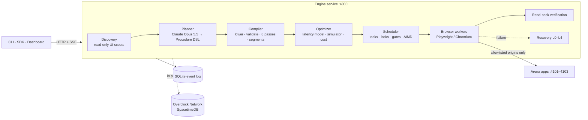

# OVERCLOCK

*AI agents shouldn't reason about every click.*

Overclock makes AI browser agents faster by compiling unfamiliar tasks into optimized,
verified execution programs instead of reasoning about every action.

> **Status (2026-10-24, Cal Hacks build).** The compiler, scheduler, browser runtime,
> recovery ladder, arena, benchmark harness, SDK, CLI, and dashboard are implemented, and most
> of them have automated tests. Mode E (the streaming pipeline, with online access-path
> substitution) has landed in code and has not been run end to end yet. The Overclock
> Network (SpacetimeDB) has a tested capability layer but is not wired into the engine.
> **No benchmark results exist yet.** See [Feature status](#feature-status) and
> [`PROGRESS.md`](PROGRESS.md).

## The problem

Most browser agents run an observe, reason, act loop: they look at the page, ask a model what
to do next, perform one action, and repeat. On a task that touches 100 records across three
web apps, with a few actions per record, that is hundreds of model calls in a row. Every call
adds model latency, the agent works on one record at a time, and the final "done" is the
model's claim rather than something the system checked.

## The approach

Overclock treats a browser task like a program to compile instead of a conversation to hold.

1. **Discover.** Scouts crawl each application in a browser context that blocks every
   state-changing request, and build an app model: pages, forms, tables, facts, and
   controls with ranked semantic locators.
2. **Plan.** A planner model (Claude Opus 5.5) writes a typed plan in the Procedure DSL. Every
   control it references must be an id it saw in the app model, and every value is an
   expression in a closed, side-effect-free language.
3. **Compile.** The compiler lowers the plan to an execution IR, rejects anything unsafe,
   runs eight optimization passes, and cuts the program into segments: short chains of
   actions on one page that one worker can run back to back.
4. **Execute.** A scheduler expands segments into per-record tasks and runs them on a pool of
   Playwright workers, with no model calls on the fast path. Resource locks, compare-and-swap
   guards, leases, and an adaptive concurrency controller keep parallel writes safe.
5. **Verify.** After every write, a worker loads a fresh page and reads the saved state back.
   A record is `VERIFIED` only when every write for it matched.
6. **Recover locally.** When the UI changes under a running program (a renamed button, a new
   modal), recovery repairs the one failing step, cheapest level first, and every later record
   reuses the repair without another observation or model call.

## Two contributions

Overclock makes two separate technical contributions. They are evaluated separately and are
never pooled into one number.

### A. First-run execution optimization

Streaming discovery, incremental compilation, and online optimization on an application that
no runtime has seen before. In mode E, workers start executing validated read fragments while
the planner is still writing the rest of the plan. Writes wait behind explicit safety gates.

**Research question:** Can this reduce total time to a correct result compared with a
stage-gated system, including all cold-start overhead?

### B. Collective execution intelligence (Overclock Network)

The Overclock Network shares validated, portable capabilities that one runtime discovered
through SpacetimeDB, so independent runtimes can reuse them safely. A capability carries the
plan plus semantic, data-free control descriptors, so a fresh runtime rebinds every control
against its own live observation before anything executes. This layer is in progress: the
capability layer is tested, but the engine doesn't use it yet.

**Research question:** Can a fresh runtime execute a compatible workflow with less discovery
and fewer model calls because another runtime already learned it?

The network work distinguishes three knowledge states:

| Knowledge state | Local cache | Network | What it measures |
| --- | --- | --- | --- |
| Global cold start | empty | nothing published | Contribution A alone |
| Local cold, network warm | empty | a validated capability exists | Contribution B: transfer between runtimes |
| Local warm | this runtime ran the task before | not used | Plain cache reuse (not a research claim) |

### What we don't claim to have invented

Cached scripts, semantic locators, parallel browser sessions, and multi-agent collaboration
all exist individually. Overclock's claims are about the combination: compiling a task with
verified writes, overlapping discovery with execution under explicit safety gates, and
transferring validated capabilities between independent runtimes.

## Architecture



Every state change in a run is an event. The engine persists each event to SQLite before it
broadcasts it, and the dashboard rebuilds the run by replaying events through the same reducer
the engine uses. See [`docs/ARCHITECTURE.md`](docs/ARCHITECTURE.md).

### Stage-gated mode D versus streaming mode E

```text
Mode D: overclock-staged (stage-gated)        Mode E: overclock (streaming)
time ───────────────────────────────▶         time ───────────────────────────────▶
discovery    █████                            discovery    ███░░░░░░  (first pass, then deeper in background)
planning          ███████                     planning        ███████  (plan streams step by step)
critique/probe           ███                  compile           ▆ ▆ ▆ ▆  (each finished step)
execution                   ██████████        read fragments      ▓▓▓▓▓▓▓▓▓▓  (canary, then fan-out)
                                              critique                  ███
                                              write fragments              ██████  (after every gate)
first browser action: after selection         first browser action: while planning continues
```

In mode D, nothing touches the browser until discovery, planning, critique, dry-run probes,
and cost-based selection have all finished. In mode E, a read fragment runs as soon as it is
closed and validated, first for one record and then for every record, while its pages are
read-only at the network layer. A write fragment waits until its phase is sealed, the whole
plan validates, side effects are classified, critique passes, and one record's write has been
verified by read-back.

## Benchmark modes

Every mode runs the same goal, records, and applications, and the arena checker judges every
mode by the same ground truth.

| Mode | Engine `--mode` | Benchmark `--mode` | Planner | Workers | What it is |
| --- | --- | --- | --- | --- | --- |
| A | `sequential-agent` | `sequential` | Claude Haiku 5.5, one call per action | 1 | Classic observe, reason, act loop. Completions are model claims, never `VERIFIED`. |
| B | `compiled-single` | `compiled` | one planner after the discovery crawl; no competing candidates, critique, or probes | 1 | Compiled program on one worker. |
| C | `compiled-parallel` | `parallel` | same as B | 8, fixed | Same program on a fixed pool. |
| D | `overclock-staged` | `staged` | adaptive swarm: up to 3 competing candidates, critique, dry-run probes, cost-based selection | up to 16, adaptive | Discovery, planning, compilation, and execution run strictly in sequence. |
| E | `overclock` | `overclock` | one streaming planner; critique before writes | up to 16, adaptive | Streaming discovery, incremental compilation, online access paths. |

### What each comparison isolates

| Comparison | Isolates |
| --- | --- |
| E vs C | The whole Overclock system against the strongest simple compiled baseline, with all cold-start overhead counted. |
| E vs D | The streaming pipeline against the stage-gated swarm, with the same compiler, scheduler, and verifier. This answers research question A. It is not stage gating alone: E also plans one strategy instead of competing several, skips dry-run probes, and adds online access paths. The `overclock-no-access-paths` ablation isolates access paths; the planning differences are not isolated. |
| D vs B | What the discovery swarm, competing strategies, and adaptive parallel scheduling add over one compiled program on one worker. |
| Network warm vs strict cold | Capability transfer between runtimes, mode E in both arms. This answers research question B. Not in the harness yet. |

The `ablations` suite also adds components one at a time and removes single features from E.
See [`docs/ARCHITECTURE.md`](docs/ARCHITECTURE.md#acceptance-tests) for what is automated.

### Metrics we report

- **Wall time** from submission, including discovery and planning, plus time per stage.
- **Time to first action** and **time to first verified action** (`firstActionMs`,
  `firstVerifiedMs`).
- **Discovery/execution overlap** (`overlapMs`): wall time during which a thinking stage and
  browser execution ran at the same time. It is 0 for a strictly stage-gated run.
- **Accuracy** from the arena checker, which holds ground truth the engine never sees.
- **Correct records per minute**, **model calls**, **tokens**, **cost**, and **cost per
  correct record**.
- **Worker utilization**, **peak concurrency**, and **recovery time**.
- **Duplicate writes**, **collateral writes**, and **verified-but-wrong records**. All three
  should be 0.
- **Network metrics** (lookups, hits, fetch and rebind time, avoided discovery). The run
  summary has fields for them, but nothing populates them yet.

### Benchmark results: pending (generated in docs/BENCHMARKS.md)

`pnpm benchmark:report` writes [`docs/BENCHMARKS.md`](docs/BENCHMARKS.md) from the result
files in `benchmarks/results/*.json`. Every number in that file comes from an executed run.
No result files exist yet.

## Quick start

You need Node.js 22.15 or later (the engine uses `node:sqlite`) and an Anthropic API key. A
TypeSafe key is optional: without it, reflex decisions fall back to deterministic rules.

1. Install dependencies and the browser:

   ```bash
   corepack enable
   pnpm install
   pnpm exec playwright install chromium
   ```

2. Create `.env` and set your keys:

   ```bash
   cp .env.example .env
   ```

   Set `ANTHROPIC_API_KEY` (planner, scouts, critique, deep repair, and mode A) and
   `TYPESAFE_API_KEY` (Jev reflex model). The arena accounts have working defaults.

3. Start each service in its own terminal:

   ```bash
   pnpm arena       # judge console at http://127.0.0.1:4100, apps on :4101–4103
   pnpm engine      # engine API at http://127.0.0.1:4000
   pnpm dashboard   # dashboard at http://localhost:3000
   ```

   `pnpm dev` points at `scripts/dev.ts`, which doesn't exist yet, so start the three
   services separately.

4. Load the demo scenario and check the engine:

   ```bash
   pnpm demo:reset    # seed 4242, t1-order-reconcile, 100 records; clears every surprise
   pnpm cli health
   ```

5. Run the task with Overclock:

   ```bash
   pnpm cli run --scenario --mode overclock
   ```

   The CLI streams progress and prints the verified result. It exits 1 unless every record
   was verified, skipped, or escalated. Mode E has not been run end to end yet. If it fails,
   run the stage-gated pipeline instead: `pnpm cli run --scenario --mode overclock-staged`.

6. Compare with ground truth:

   ```bash
   pnpm cli check
   ```

Each run spends model money. `OVERCLOCK_BENCH_BUDGET_USD` caps benchmark spend (default $50).

## Tests

| Command | What it covers | Model spend |
| --- | --- | --- |
| `pnpm test` | Unit: expressions, compiler, incremental compiler, plan stream, scheduler, optimizer, redaction, arena oracle, benchmark harness, SDK, CLI. | none |
| `pnpm test:integration` | Arena apps, browser runtime, perception, engine API and store, SDK against real servers, scripted mode A. | none unless `OVERCLOCK_LIVE=1` |
| `pnpm test:adversarial` | Recovery L0/L1 against a fixture app with every UI surprise; refusal to guess; repair dedupe. | none unless `OVERCLOCK_LIVE=1` |
| `pnpm test:e2e` | Dashboard against a synthetic, test-only replay server (Playwright). | none |
| `pnpm typecheck` | TypeScript across the workspace and the dashboard. | none |
| `npx vitest run -c tests/network-capability/vitest.config.ts` | Capability export, sanitizer, static analysis, rebinding, and the validation worker, against the arena in-process. | none |
| `npx vitest run --config tests/network/vitest.config.ts` | Network client and SpacetimeDB module against a real local SpacetimeDB (ephemeral database, deleted afterwards). Needs the `spacetime` CLI. | none |

Setting `OVERCLOCK_LIVE=1` enables tests that call Claude and Jev, so they spend money.

## Security and permission model

- **Origin allowlists.** Every browser context aborts requests to origins outside the run's
  applications, and the compiler rejects navigation outside them.
- **Read-only exploration.** Scouts and dry-run probes use contexts that abort every non-GET
  request, risky GETs such as `/logout` or `?action=`, and WebSockets, with service workers
  blocked. Exploration signs in with a read-only viewer account when the app has one.
- **Read-only fragments.** While a worker runs a read segment, its page is read-only at the
  network layer, so an unexpected write is blocked and fails the task.
- **Plans can't invent targets.** The planner may only reference observed control ids and the
  closed expression language. Page content is passed to models as untrusted data.
- **Every write is verified.** Writes must declare resources, carry a read-back check, and use
  a `verify-before-retry` or `never` retry policy. An uncertain write is reconciled by reading
  state back, never blindly retried.
- **Irreversible actions need a person.** Payments, deletions, refunds, and sends require
  approval, and recovery never repairs them with a model.
- **Credentials stay in the engine's environment.** Run configs can't carry them, and events
  and stored configs are redacted.

Full details: [`docs/SECURITY.md`](docs/SECURITY.md).

## Known limitations

- Mode E is new code with no end-to-end test or recorded run yet. It also writes the local
  program cache but never reads it, so a warm-cache mode E run repeats discovery and planning.
- Online access-path substitution is wired into mode E only and has no test. No other online
  re-optimization exists, so the `onlineReoptimization` switch only turns access paths off.
- The Overclock Network is not connected to the engine. The `network-read` and
  `network-read-and-contribute` knowledge policies are accepted but behave like a cold run.
- Approving an irreversible step records the decision but doesn't re-run the step: the task
  is already terminal when the approval arrives.
- The executor, staged swarm, crawler, dry run, and effect classification have no automated
  tests. They are exercised only by live runs.
- The locator-reuse pass reports shared control references, but the runtime has no per-worker
  locator cache yet.
- Bulk-import operations are detected but never planned, because read-back verification
  covers one entity per write.
- The engine and arena admin APIs have no authentication. Both bind to `127.0.0.1` and allow
  CORS only from localhost origins.
- One integration test (`arena.test.ts`, "applies surprises and validates variation edits")
  fails because it still expects three apps.

## Feature status

Labels: **Working (tested)** means automated tests cover it. **Partial** means it is
implemented but untested end to end or has a known gap. **In progress** means code is being
written or not wired in. **Proposed** means design only.

| Feature | Status | Evidence |
| --- | --- | --- |
| Procedure DSL, expression language, lowering, IR validation | Working (tested) | `tests/unit/compiler.test.ts`, `tests/unit/expr.test.ts` |
| Optimizer passes and segment formation | Working (tested) | `tests/unit/compiler.test.ts` |
| Locator-reuse pass | Partial | Reports only; no runtime cache |
| Incremental compiler and plan stream watcher | Working (tested) | `tests/unit/incremental.test.ts`, `tests/unit/plan-stream.test.ts` |
| Scheduler: expansion, dependencies, locks, critical path, invalidation, AIMD | Working (tested) | `tests/unit/scheduler.test.ts` |
| Scheduler gates (canary, deferred) and incremental phases | Partial | Implemented; no unit test |
| Latency model, list-scheduling simulator, cost model, worker choice | Working (tested) | `tests/unit/optimizer.test.ts` |
| Browser guards, read-back, uncertain-write detection | Working (tested) | `tests/integration/runtime.test.ts` |
| Read-only pages during read fragments | Partial | Implemented in `BrowserManager` and `Executor`; no test |
| Recovery L0/L1, L4 escalation, repair dedupe | Working (tested) | `tests/adversarial/recovery.test.ts` |
| Recovery L2 (Jev) and L3 (Claude) | Partial | Live tests gated behind `OVERCLOCK_LIVE=1` |
| Executor (leases, reconciliation, invalidation, watchdog) | Partial | Runs in local development; no automated test |
| Mode A sequential baseline | Working (tested) | `tests/integration/baseline.test.ts` (scripted model) |
| Modes B, C, D (staged swarm) | Partial | Implemented; no automated end-to-end test |
| Mode E streaming pipeline | In progress | `services/engine/src/streaming.ts`; not yet run |
| Access-path substitution | In progress | `services/engine/src/accessPaths.ts`, wired into mode E; no test |
| Other online strategy re-optimization | Proposed | Not implemented |
| Approvals for irreversible steps | Partial | Request works; approved steps don't resume |
| Event log, SQLite store, restart recovery, SSE resume | Working (tested) | `tests/integration/engine-api.test.ts` |
| Cold-start metrics (`firstVerifiedMs`, `overlapMs`) | Working (tested) | Replayed scripted events in `engine-api.test.ts` |
| SDK and CLI | Working (tested) | `tests/unit/sdk.test.ts`, `tests/integration/sdk-*.test.ts` |
| Dashboard | Working (tested) | `tests/e2e/dashboard.spec.ts` against the replay server |
| Arena apps, judge console, surprises, checker | Working (tested) | `tests/integration/arena.test.ts` (1 stale failure), `tests/unit/arena-oracle.test.ts` |
| Benchmark harness, suites, report, holdout freeze gate | Working (tested) | `tests/unit/benchmark.test.ts` |
| Benchmark results | Pending | `benchmarks/results/` is empty |
| Capability export, sanitizer, static analysis, rebinding, validation worker | Partial | `tests/network-capability/` (23 tests passed on 2026-10-24); not used by the engine |
| SpacetimeDB module and network client | In progress | `tests/network/` against a real local SpacetimeDB; not run for this report |
| Engine integration with the network | Proposed | Not wired |

## Cal Hacks context and tech stack

Overclock was built at Cal Hacks in October 2026. The arena (three web apps plus a judge
console) exists so judges can change the UI while a run executes and check the result against
ground truth the engine never sees. A structurally different fourth application is held out:
it is evaluated only after a code freeze, so the engine can't be tuned to it.

- **Language:** TypeScript across a pnpm workspace, on Node.js 22.15 or later.
- **Browser:** Playwright with Chromium.
- **Models:** Claude Opus 5.5 as the planner, Claude Haiku 5.5 for helper tasks, and the
  TypeSafe Jev reflex model for typed choices (effect classification and repair decisions).
- **Storage:** SQLite (`node:sqlite`, WAL mode) for the engine's event log.
- **Network:** SpacetimeDB 2.x for the Overclock Network.
- **Services:** Fastify for the engine and the arena; zod for every contract.
- **Dashboard:** Next.js, React, Tailwind CSS, React Flow, and Recharts.

## Documentation

- [`docs/ARCHITECTURE.md`](docs/ARCHITECTURE.md): components, events, gates, correctness,
  recovery, cost model, cold-start pipelines, network, acceptance tests.
- [`docs/ACTION_IR.md`](docs/ACTION_IR.md): Procedure DSL, IR, expression language,
  validation rules.
- [`docs/SECURITY.md`](docs/SECURITY.md): permission model and trust boundaries.
- [`docs/NETWORK.md`](docs/NETWORK.md): Overclock Network design, status, and setup.
- [`docs/DEMO.md`](docs/DEMO.md): judging script and reset procedure.
- [`docs/BENCHMARKS.md`](docs/BENCHMARKS.md): generated from real results only.
- [`PROGRESS.md`](PROGRESS.md): status by milestone.
