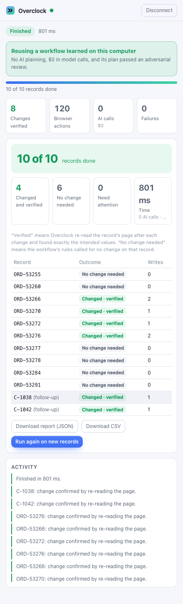
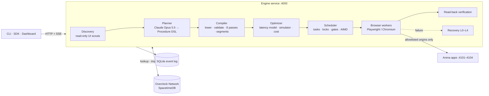

# OVERCLOCK

*AI agents shouldn't reason about every click.*

Overclock makes AI browser agents faster by compiling unfamiliar tasks into optimized,
verified execution programs instead of reasoning about every action.

> **Status (2026-10-24, Cal Hacks build).** Every component is implemented, and most have
> automated tests. Every number below was graded by the arena's independent ground-truth
> checker. With Claude Opus 5.5 fast mode for planning and critique, a cold mode E run takes
> about 19 s for 25 records and 42 s for 500 (500/500 correct). After the website's save
> buttons were renamed, a second, independent runtime imported the first runtime's capability
> through SpacetimeDB, rebound it, and finished 10 records in a median 2.05 s with no planning
> call. A fresh cold runtime took 18.8 s, measured before B's latest startup changes; allowing
> for its own share of them, B is about 8.9× faster. 5 of 5 seeds, all records correct
> ([`docs/NETWORK.md`](docs/NETWORK.md#results)). A runtime publishes only when every record
> verified and every skipped write has evidence of a legitimate no-op; under that gate seed 4242
> no longer publishes (its hold rule never fires), while 1111, 2222, 3333, 5151, 6262, and 7777
> do. A request that differs in any value, threshold, or condition never reuses another
> operation's plan: in a live run it found no capability and made zero writes. Warm, the engine
> reconciles 500 records across three apps in a median 13.8 s (with other apps busy on the
> machine) with every write verified by a fresh read (500/500), and the first verified write
> lands in under a second. The judging demo and a recorded fallback are in
> [`docs/DEMO.md`](docs/DEMO.md). See [Benchmark
> results](#benchmark-results-2026-10-24), [Feature status](#feature-status), and
> [`PROGRESS.md`](PROGRESS.md).

## Overclock for Chrome

**Describe it. Approve it. Overclock runs it.** The Chrome extension (`apps/extension`) is the
customer interface. Pick a workflow Overclock has learned, or describe a new task. Drop a CSV of
records, review every step and which ones change data, approve, and watch the run finish with
each change verified by re-reading the page. Reruns reuse the learned workflow with no AI
planning; a teammate's validated workflow can be imported from the Overclock Network. Tasks run
in Overclock's own browser on your computer, not in your Chrome tabs, and the demonstration
environment is the arena's mock apps. Setup, security model, and a 90-second customer demo:
[`docs/EXTENSION.md`](docs/EXTENSION.md).



## The problem

Most browser agents run an observe, reason, act loop: they look at the page, ask a model what
to do next, perform one action, and repeat. On a task that touches 100 records across three
web apps, with a few actions per record, that is hundreds of model calls in a row. Every call
adds model latency, the agent works on one record at a time, and the final "done" is the
model's claim rather than something the system checked.

## The approach

Overclock treats a browser task like a program to compile instead of a conversation to hold.

1. **Discover.** Scouts crawl each application in a browser context that blocks every
   state-changing request, and build an app model: pages, forms, tables, facts, and
   controls with ranked semantic locators.
2. **Plan.** A planner model (Claude Opus 5.5) writes a typed plan in the Procedure DSL. Every
   control it references must be an id it saw in the app model, and every value is an
   expression in a closed, side-effect-free language.
3. **Compile.** The compiler lowers the plan to an execution IR, rejects anything unsafe,
   runs eight optimization passes, and cuts the program into segments: short chains of
   actions on one page that one worker can run back to back.
4. **Execute.** A scheduler expands segments into per-record tasks and runs them on a pool of
   Playwright workers, with no model calls on the fast path. Resource locks, compare-and-swap
   guards, leases, and an adaptive concurrency controller keep parallel writes safe.
5. **Verify.** After every write, a worker loads a fresh page and reads the saved state back.
   A record is `VERIFIED` only when every write for it matched.
6. **Recover locally.** When the UI changes under a running program (a renamed button, a new
   modal), recovery repairs the one failing step, cheapest level first, and every later record
   reuses the repair without another observation or model call.

## Two contributions

Overclock makes two separate technical contributions. They are evaluated separately and are
never pooled into one number.

### A. First-run execution optimization

Streaming discovery, incremental compilation, and online optimization on an application that
no runtime has seen before. In mode E, workers start executing validated read fragments while
the planner is still writing the rest of the plan. Writes wait behind explicit safety gates.

**Research question:** Can this reduce total time to a correct result compared with a
stage-gated system, including all cold-start overhead?

### B. Collective execution intelligence (Overclock Network)

The Overclock Network shares validated, portable capabilities that one runtime discovered
through SpacetimeDB, so independent runtimes can reuse them safely. A capability carries the
plan plus semantic, data-free control descriptors, so a fresh runtime rebinds every control
against its own live observation before anything executes. In five recorded runs (10 records,
local arena, five seeds), every edit form's save button was renamed after runtime A learned the
workflow. Runtime B, with its own identity and an empty cache, imported A's capability, rebound
the renamed buttons by structure, wrote behind a write canary, and finished in a median 3.3 s
with no planning call, against 18.8 s for a fresh strict-cold runtime on the same records and
interface (5.9×). Every run of every arm passed the arena's ground-truth check. With rebinding
and login now running per app in parallel and the browser pool launched at engine startup, B
takes a median 2.05 s on the same seeds (first verified write 1.45 s); C wasn't re-measured,
and against its earlier 18.8 s that is 9.2×, or about 8.9× allowing for C's own faster startup. When the edit
fields were moved into a tab instead, B refused the capability, guessed nothing, and planned
cold. See [`docs/NETWORK.md`](docs/NETWORK.md#results) and the dashboard's Transfer page.

**Research question:** Can a fresh runtime execute a compatible workflow with less discovery
and fewer model calls because another runtime already learned it?

The network work distinguishes three knowledge states:

| Knowledge state | Local cache | Network | What it measures |
| --- | --- | --- | --- |
| Global cold start | empty | nothing published | Contribution A alone |
| Local cold, network warm | empty | a validated capability exists | Contribution B: transfer between runtimes |
| Local warm | this runtime ran the task before | not used | Plain cache reuse (not a research claim) |

### What we don't claim to have invented

Cached scripts, semantic locators, parallel browser sessions, and multi-agent collaboration
all exist individually. Overclock's claims are about the combination: compiling a task with
verified writes, overlapping discovery with execution under explicit safety gates, and
transferring validated capabilities between independent runtimes.

## Architecture



Every state change in a run is an event. The engine persists each event to SQLite before it
broadcasts it, and the dashboard rebuilds the run by replaying events through the same reducer
the engine uses. See [`docs/ARCHITECTURE.md`](docs/ARCHITECTURE.md).

### Stage-gated mode D versus streaming mode E

```text
Mode D: overclock-staged (stage-gated)        Mode E: overclock (streaming)
time ───────────────────────────────▶         time ───────────────────────────────▶
discovery    █████                            discovery    ███░░░░░░  (first pass, then deeper in background)
planning          ███████                     planning        ███████  (plan streams step by step)
critique/probe           ███                  compile           ▆ ▆ ▆ ▆  (each finished step)
execution                   ██████████        read fragments      ▓▓▓▓▓▓▓▓▓▓  (canary, then fan-out)
                                              critique                  ███
                                              write fragments              ██████  (after every gate)
first browser action: after selection         first browser action: while planning continues
```

In mode D, nothing touches the browser until discovery, planning, critique, dry-run probes,
and cost-based selection have all finished. In mode E, a read fragment runs as soon as it is
closed and validated, first for one record and then for every record, while its pages are
read-only at the network layer. A write fragment waits until its phase is sealed, the whole
plan validates, side effects are classified, critique passes, and one record's write has been
verified by read-back.

## Benchmark modes

Every mode runs the same goal, records, and applications, and the arena checker judges every
mode by the same ground truth.

| Mode | Engine `--mode` | Benchmark `--mode` | Planner | Workers | What it is |
| --- | --- | --- | --- | --- | --- |
| A | `sequential-agent` | `sequential` | Claude Haiku 5.5, one call per action | 1 | Classic observe, reason, act loop. Completions are model claims, never `VERIFIED`. |
| B | `compiled-single` | `compiled` | one planner after the discovery crawl; no competing candidates, critique, or probes | 1 | Compiled program on one worker. |
| C | `compiled-parallel` | `parallel` | same as B | 8, fixed | Same program on a fixed pool. |
| D | `overclock-staged` | `staged` | adaptive swarm: up to 3 competing candidates, critique, dry-run probes, cost-based selection | up to 16, adaptive | Discovery, planning, compilation, and execution run strictly in sequence. |
| E | `overclock` | `overclock` | one streaming planner; critique before writes | up to 16, adaptive | Streaming discovery, incremental compilation, online access paths. |

### What each comparison isolates

| Comparison | Isolates |
| --- | --- |
| E vs C | The whole Overclock system against the strongest simple compiled baseline, with all cold-start overhead counted. |
| E vs D | The streaming pipeline against the stage-gated swarm, with the same compiler, scheduler, and verifier. This answers research question A. It is not stage gating alone: E also plans one strategy instead of competing several, skips dry-run probes, and adds online access paths. The `overclock-no-access-paths` ablation isolates access paths; the planning differences are not isolated. |
| D vs B | What the discovery swarm, competing strategies, and adaptive parallel scheduling add over one compiled program on one worker. |
| Network warm vs strict cold | Capability transfer between runtimes, mode E in both arms, same scenario, separate fresh runtimes. This answers research question B. Measured by `pnpm network:demo`, not by the benchmark harness. |

The `ablations` suite also adds components one at a time and removes single features from E.
See [`docs/ARCHITECTURE.md`](docs/ARCHITECTURE.md#acceptance-tests) for what is automated.

### Metrics we report

- **Wall time** from submission, including discovery and planning, plus time per stage.
- **Time to first action** and **time to first verified action** (`firstActionMs`,
  `firstVerifiedMs`).
- **Discovery/execution overlap** (`overlapMs`): wall time during which a thinking stage and
  browser execution ran at the same time. It is 0 for a strictly stage-gated run.
- **Accuracy** from the arena checker, which holds ground truth the engine never sees.
- **Correct records per minute**, **model calls**, **tokens**, **cost**, and **cost per
  correct record**.
- **Worker utilization**, **peak concurrency**, and **recovery time**.
- **Duplicate writes**, **collateral writes**, and **verified-but-wrong records**. All three
  should be 0.
- **Network metrics** (lookups, hits, the compatibility outcome, lookup, fetch, and rebind
  time, and whether the run published), in `RunSummary.network`.

### Benchmark results (2026-10-24)

[`docs/BENCHMARKS.md`](docs/BENCHMARKS.md) is generated from the result files in
`benchmarks/results/` by `pnpm benchmark:report`. Every number in it comes from an executed
run. The morning round below was measured at standard speed, before the review-gate, critique,
and expression-language changes; the next section has the paired runs on the current code. The
morning result file has 34 runs of modes B, C, D, and E on `t1-order-reconcile` seed
4242: 3 trials per mode at 25 records under two conditions (local, and realistic injected
latency), a warm repeat after every cold E run, and one 100-record run per mode. No run failed.
Median accuracy was 100% in every group. Across all runs, 0 records were reported VERIFIED but
wrong, with 0 duplicate and 0 collateral writes. Modes A and the external baseline were not run
in this round.

| Comparison (median wall time) | Local, 25 records | Realistic latency, 25 records | Local, 100 records (n=1) |
| --- | --- | --- | --- |
| **E vs D** (research question A) | 95.8 s vs 3.2 min: **1.98×** | 2.1 min vs 3.0 min: **1.48×** | 107 s vs 2.5 min: **1.38×** |
| **E vs C** | 95.8 s vs 42.4 s: **0.44×** (E slower) | 2.1 min vs 95.6 s: **0.78×** | 107 s vs 58 s: **0.54×** |
| E warm repeat | 2.1 s, no model calls | 5.9 s, no model calls | — |

What this shows:

- **Streaming beats stage gating.** E reached a correct result 1.4–2× faster than D with the
  same compiler, scheduler, verifier, and critique gate, including every cold-start cost. It
  also cost about a third as much ($0.34–0.39 against about $1 per run), because it plans one
  strategy instead of competing several.
- **E is slower than C.** C is one planner with no critique and no dry run. E's write gate
  (critique, a median of 15–17 s, plus a repair round of 40–55 s whenever the critique flags a
  high-severity risk) costs more than overlapping reads with planning saves on this arena,
  where execution takes seconds. The overlap is real (88–105 s of reads ran during planning),
  but it has little to hide here.
- **Holdout.** After a code freeze, E, D, and C each ran an unseen task (t3) on the known apps
  and the unfamiliar fourth app (t4), under both conditions. t3: 25/25 in all 6 runs (E 54.4 s
  and 31.3 s, D 67.4 s and 67.4 s, C 16.2 s and 20.8 s). t4: all 6 runs failed at sign-in,
  before any write, because the generic login didn't recognize the app's username field. The
  system doesn't yet generalize to an unfamiliar login form.
- **Errors were reported, not hidden.** C under realistic latency left 5 records `UNCONFIRMED`
  in one trial. D (realistic latency, one trial) and B (local, one trial) each missed one
  cross-record customer hold and reported the affected orders as `SKIPPED`: 4 records that were
  wrong decisions, not failed writes.

### Planner speed, the review gate, and scale (2026-10-24, afternoon)

Paired cold runs of mode E and C on the same scenario (t1, seed 4242, 25 records, local), with
the arena checker grading every run. "Fast" is Claude Opus 5.5 with `speed: "fast"` for the
planner and for the critique; "standard" is the earlier default (Opus standard planner, Haiku
critique). Result files: `benchmarks/results/*@e2-*.json` and `*@c-*.json`.

| Configuration | Runs | Wall time | First verified write | Correct | Cost per run |
| --- | --- | --- | --- | --- | --- |
| E, fast planner and critique | 3 | 18.7, 18.8, 21.6 s | 17.4–20.5 s | 3 of 3 runs 25/25 | $0.42–0.46 |
| E, standard planner, Haiku critique | 3 | 52.0, 53.5 s; one run failed closed | 50.7–52.2 s | 2 of 3 runs 25/25; the third wrote nothing | $0.15–0.26 |
| C, fast planner (no critique) | 2 | 16.1, 20.5 s | 15.4–19.5 s | 2 of 2 runs 25/25 | $0.30–0.35 |
| C, standard planner (no critique) | 2 | 37.4, 52.6 s | 36.8–51.8 s | 2 of 2 runs 25/25 | $0.15–0.18 |

- **Where the time went.** Fast mode streams planner output at about 410 tokens/s against about
  150 at standard speed (time to first token is about 1 s for both), so planning dropped from
  33–35 s to 13 s. The Opus fast critique takes 3.5–5 s. Output throughput alone isn't the
  speedup: the earlier fast runs spent 8–9 s more per run on a repair round, which the fixes
  below removed.
- **What removed the repairs.** Every repair in the first paired round came from one finding:
  the plan matched CRM emails against a lowercased order email, and the expression language had
  no way to normalize the list side. A `~=` operator for `filterBy` (case- and
  whitespace-insensitive on both sides) fixed the plans; the critique then passed the same
  recorded plan 3 of 3 times, against 0 of 3 before, and still caught both rules deliberately
  removed from it. The critique's first token budget also went from 3,000 to 8,000 tokens,
  which ended a truncate-and-retry that cost about 14 s.
- **E now matches C** on wall time while keeping the review gate and the write canary.
- **The standard configuration failed closed once.** Its Haiku critique reported a missing rule
  that the repaired plan did implement, so the review rejected the plan and no write ran (0
  duplicate, 0 collateral writes). Opus fast reported consistent findings in the offline
  evaluation, which is why it is the default critic now.
- **500 records**, one cold run (`*@scale-fast.json`): 42.3 s wall, 500/500 correct, 0
  duplicate and 0 collateral writes, $0.45. Planning and critique take the first 22.5 s while
  reads run underneath; the write canaries take about 3 s; then 16 workers verify about 25–36
  writes per second. The earlier 500/500 run took about 120 s.

### Execution throughput (2026-10-24, evening)

Warm runs reuse a cached, reviewed plan and make no model calls, so they measure execution alone.
`scripts/warm-bench.ts`, t1 seed 4242, 500 records, 16 workers, one excluded warm-up, then 3
trials; results in `benchmarks/results/warm/`.

| Engine | Median wall (range) | Correct |
| --- | --- | --- |
| Final: records complete in order, one selector-engine setup per page | **13.8 s** (13.8–14.1), first verified write **0.89 s** | 500/500 in every trial, 0 duplicate, 0 collateral writes |
| Before this evening's changes, in the same alternating trials (heavier machine load) | 15.9 s (15.8–16.3), first verified write 8.6 s | 500/500 |
| Single-page tables read in one round of calls | 13.3 s (13.2–13.6) | 500/500 in every trial, 0 duplicate, 0 collateral writes |
| Before that, in the same alternating trials (same machine load) | 14.8 s (14.8–15.8) | 500/500 |
| 4 browsers, each behind its own server process; XPath-anchored fields read in one page call | 14.8 s (14.7–15.5) | 500/500 in every trial, 0 duplicate, 0 collateral writes |
| Before the batched reads | 17.2 s (17.0–17.3) | 500/500 |
| Before the batched reads, one browser in the engine's process | 23.9 s | 500/500 |
| Before today's execution changes (same procedure, not recorded to a file) | 29.1 s | 500/500 |

First the engine's single thread and Chromium's main process were the limit; now the machine
itself is (80–83% CPU busy during a run, almost all of it Chromium loading and rendering about
3,300 pages). More workers no longer help: 8 workers take 18.2 s, 16 take about 15 s, and two
engines splitting the records finish no sooner. See [Execution
throughput](docs/ARCHITECTURE.md#execution-throughput). One cold 500-record run on
the new execution code (a cache miss after the operation-identity change, not a planned
benchmark) took 27.9 s and was 500/500 correct.

## Quick start

You need Node.js 22.15 or later (the engine uses `node:sqlite`) and an Anthropic API key. A
TypeSafe key is optional: without it, reflex decisions fall back to deterministic rules.

1. Install dependencies and the browser:

   ```bash
   corepack enable
   pnpm install
   pnpm exec playwright install chromium
   ```

2. Create `.env` and set your keys:

   ```bash
   cp .env.example .env
   ```

   Set `ANTHROPIC_API_KEY` (planner, scouts, critique, deep repair, and mode A) and
   `TYPESAFE_API_KEY` (Jev reflex model). The arena accounts have working defaults.

3. Start each service in its own terminal:

   ```bash
   pnpm arena       # judge console at http://127.0.0.1:4100, apps on :4101–4104
   pnpm engine      # engine API at http://127.0.0.1:4000
   pnpm dashboard   # dashboard at http://localhost:3000
   ```

   The arena's ports come from `OVERCLOCK_ARENA_ADMIN_PORT` (4100) and
   `OVERCLOCK_ARENA_CRM_PORT`, `OVERCLOCK_ARENA_ORDERS_PORT`, `OVERCLOCK_ARENA_SUPPORT_PORT`,
   and `OVERCLOCK_ARENA_APP4_PORT` (4101–4104). The fourth app is the holdout. `pnpm dev`
   starts all three in one terminal with prefixed output.

4. Load the demo scenario and check the engine:

   ```bash
   pnpm demo:reset    # seed 4242, t1-order-reconcile, 100 records; clears every surprise
   pnpm cli health
   ```

5. Run the task with Overclock:

   ```bash
   pnpm cli run --scenario --mode overclock
   ```

   The CLI streams progress and prints the verified result. It exits 1 unless every record
   was verified, skipped, or escalated. `--mode overclock-staged` runs the stage-gated
   pipeline (mode D) instead.

6. Compare with ground truth:

   ```bash
   pnpm cli check
   ```

7. Optional: transfer a capability between runtimes through the Overclock Network:

   ```bash
   pnpm network:dev     # local SpacetimeDB on ws://127.0.0.1:3100, module published
   pnpm network:demo    # runtime A discovers and publishes; B imports; fresh C runs cold
   ```

   The demo exits 1 unless both runtimes pass the arena checker, B imported and executed the
   capability, and B made no planner call.

Each run spends model money. `OVERCLOCK_BENCH_BUDGET_USD` caps benchmark spend (default $50).

## Tests

| Command | What it covers | Model spend |
| --- | --- | --- |
| `pnpm test` | Unit: expressions, compiler (guards, page re-opening), incremental compiler, a recorded live plan stream, scheduler (invalidation, approvals, saturation-aware concurrency), optimizer, redaction, arena oracle, benchmark harness, SDK, CLI, the engine's network service, the model-stream stall watchdog, fast mode against a fake Messages API, the review gate, and input-record accounting. | none |
| `pnpm test:integration` | Arena apps, browser runtime (including risky GETs on read-only pages and the single-page table read), perception (including region facts), engine API and store, SDK against real servers, scripted mode A, the executor end to end on a fixture app (entry verification, duplicate, rejected, and ambiguous submissions, the invalidation regression, derived-record outcomes), and the mode D and mode E review gates with a scripted model. | none unless `OVERCLOCK_LIVE=1` |
| `pnpm test:adversarial` | Recovery L0/L1 against a fixture app with every UI surprise; refusal to guess; repair dedupe. | none unless `OVERCLOCK_LIVE=1` |
| `pnpm test:e2e` | Dashboard against a synthetic, test-only replay server (Playwright). | none |
| `pnpm typecheck` | TypeScript across the workspace and the dashboard. | none |
| `pnpm test:network-capability` | Capability export, sanitizer, static analysis, rebinding, and the validation worker, against the arena in-process. | none |
| `pnpm test:network` | Network client and SpacetimeDB module against a real local SpacetimeDB (ephemeral database, deleted afterwards). Needs the `spacetime` CLI. | none |

Setting `OVERCLOCK_LIVE=1` enables tests that call Claude and Jev, so they spend money.

## Security and permission model

- **Origin allowlists.** Every browser context aborts requests to origins outside the run's
  applications, and the compiler rejects navigation outside them.
- **Read-only exploration.** Scouts and dry-run probes use contexts that abort every non-GET
  request, risky GETs such as `/logout` or `?action=`, and WebSockets, with service workers
  blocked. Exploration signs in with a read-only viewer account when the app has one.
- **Read-only fragments.** While a worker runs a read segment, its page is read-only at the
  network layer: non-GET requests and risky GETs (such as `/logout`) are blocked, and an
  unexpected write fails the task.
- **No reuse across different operations.** A cached plan or network capability runs only for
  the exact instructions it was learned for: a different value, threshold, or condition plans
  cold. No model decides that two requests are similar enough to share writes.
- **No unreviewed writes.** When the policy requires a critique (modes D and E, more than five
  records), every write waits for a passed critique of that exact plan; a repaired plan is
  critiqued again, and an unavailable critique rejects the plan (fail-closed). Only reviewed
  plans are cached for warm starts or published to the network.
- **Plans can't invent targets.** The planner may only reference observed control ids and the
  closed expression language. Page content is passed to models as untrusted data.
- **Every write is verified.** Writes must declare resources, carry a read-back check, and use
  a `verify-before-retry` or `never` retry policy. An uncertain write is reconciled by reading
  state back, never blindly retried.
- **Irreversible actions need a person.** Payments, deletions, refunds, and sends require
  approval, and recovery never repairs them with a model.
- **Credentials stay in the engine's environment.** Run configs can't carry them, and events
  and stored configs are redacted.

Full details: [`docs/SECURITY.md`](docs/SECURITY.md).

## Known limitations

- Mode E plans one strategy and runs no dry-run probes, while mode D can compete candidates and
  probe them. E versus D measures those differences together with the overlap.
- The review gate is only as precise as its critic. A false-positive finding costs a repair
  round, and one that survives the repair rejects the run (recorded once with the Haiku
  critic). The default Opus fast critic costs about $0.13–0.15 per critique.
- Reuse requires the exact same instructions (any different value, number, or condition is a
  different operation), so instructions that state the batch size ("these 25 orders") don't share
  a plan with the same instructions for another size.
- Fast mode is a Claude API research preview at twice the standard price; a cold 25-record
  mode E run costs about $0.43 instead of $0.15. A refused fast request falls back to standard
  speed automatically.
- A plan's decision to skip an append (for example "the note is already there") reads the
  section's text with `contains()`, so a longer unrelated entry can cause a skip. Verification
  never accepts that case: an appended entry is `VERIFIED` only when exactly one entry equals
  it on the targeted record's page.
- Online access-path substitution is wired into mode E only and has no test. No other online
  re-optimization exists, so the `onlineReoptimization` switch only turns access paths off.
- The engine reports reuse of imported capabilities but doesn't start network repair jobs
  after a capability breaks; it discovers cold instead.
- Publication evidence for skipped writes has no independent oracle. "Rule applied" shows a
  write template fires and verifies in the run, not that its condition is right for every
  record (the adversarial review checks that), and legitimate exceptions it never sees work,
  such as a hold rule whose only candidate is a VIP, block publication.
- The final demo's runtime A replays a plan it learned and reviewed in an earlier run (no model
  calls). The cold version is recorded in `benchmarks/results/network/` but costs model calls.
- The crawler, dry run, and effect classification have no automated tests of their own, and
  the critique's judgement is measured only by the offline evaluation and live runs. The
  pipelines' review gate is tested with a scripted model.
- Bulk-import operations are detected but never planned, because read-back verification
  covers one entity per write.
- Sign-in is generic: it looks for a password field plus an email, text, or user-named input.
  It failed on the holdout app's login form, so every holdout run on that app failed before
  discovery.
- The engine and arena admin APIs have no authentication. Both bind to `127.0.0.1` and allow
  CORS only from localhost origins.

## Feature status

Labels: **Working (tested)** means automated tests cover it. **Partial** means it is
implemented but untested end to end or has a known gap. **In progress** means code is being
written or not wired in. **Proposed** means design only.

| Feature | Status | Evidence |
| --- | --- | --- |
| Procedure DSL, expression language (with arithmetic), lowering, IR validation | Working (tested) | `tests/unit/compiler.test.ts`, `tests/unit/expr.test.ts` |
| Compiler-added and compiler-dropped guards; page re-opening for read-decide-act chains | Working (tested) | `tests/unit/compiler.test.ts` |
| Optimizer passes and segment formation | Working (tested) | `tests/unit/compiler.test.ts` |
| Incremental compiler and plan stream watcher | Working (tested) | `tests/unit/incremental.test.ts`, `tests/unit/plan-stream.test.ts`, `tests/unit/stream-replay.test.ts` (a recorded live stream) |
| Scheduler: expansion, dependencies, locks, critical path, invalidation, AIMD, approval parking | Working (tested) | `tests/unit/scheduler.test.ts` |
| Latency model, list-scheduling simulator, cost model, worker choice | Working (tested) | `tests/unit/optimizer.test.ts` |
| Browser guards, read-back, uncertain-write detection | Working (tested) | `tests/integration/runtime.test.ts` |
| Region facts and exactly-one-entry verification of appended entries | Working (tested) | `tests/integration/perception.test.ts`, `tests/integration/entry-verification.test.ts` |
| Executor: reconciliation, duplicates, rejected and ambiguous submissions, invalidation after a committed write | Working (tested) | `tests/integration/entry-verification.test.ts` |
| Recovery L0/L1, L4 escalation, repair dedupe | Working (tested) | `tests/adversarial/recovery.test.ts` |
| Recovery L2 (Jev) and L3 (Claude) | Partial | Live tests gated behind `OVERCLOCK_LIVE=1` |
| Mode A sequential baseline | Working (tested) | `tests/integration/baseline.test.ts` (scripted model) |
| Modes B, C, D, E | Working (measured) | [`docs/BENCHMARKS.md`](docs/BENCHMARKS.md) |
| Access-path substitution | Partial | Wired into mode E; no test |
| Other online strategy re-optimization | Proposed | Not implemented |
| Model-stream stall watchdog | Working (tested) | `tests/unit/model-stall.test.ts` |
| Event log, SQLite store, restart recovery, SSE resume | Working (tested) | `tests/integration/engine-api.test.ts` |
| Cold-start metrics (`firstVerifiedMs`, `overlapMs`) | Working (tested) | `tests/integration/engine-api.test.ts` |
| SDK and CLI | Working (tested) | `tests/unit/sdk.test.ts`, `tests/integration/sdk-*.test.ts` |
| Dashboard | Working (tested) | `tests/e2e/dashboard.spec.ts` against the replay server |
| Arena apps, judge console, surprises, checker | Working (tested) | `tests/integration/arena.test.ts`, `tests/unit/arena-oracle.test.ts` |
| Benchmark harness, suites, report, holdout freeze gate | Working (tested) | `tests/unit/benchmark.test.ts` |
| Capability export, sanitizer, static analysis, rebinding, validation worker | Working (tested) | `pnpm test:network-capability` |
| SpacetimeDB module and network client | Working (tested) | `pnpm test:network` against a real local SpacetimeDB |
| Engine integration with the network (lookup, import, publish, reuse) | Working (one recorded run) | `pnpm network:demo`; [`docs/NETWORK.md`](docs/NETWORK.md#results) |
| Engine-started network repair jobs | Proposed | Client-level repair leases are tested; the engine doesn't start them |

## Cal Hacks context and tech stack

Overclock was built at Cal Hacks in October 2026. The arena (three web apps plus a judge
console) exists so judges can change the UI while a run executes and check the result against
ground truth the engine never sees. A structurally different fourth application is held out:
it is evaluated only after a code freeze, so the engine can't be tuned to it.

- **Language:** TypeScript across a pnpm workspace, on Node.js 22.15 or later.
- **Browser:** Playwright with Chromium.
- **Models:** Claude Opus 5.5 as the planner, Claude Haiku 5.5 for helper tasks, and the
  TypeSafe Jev reflex model for typed choices (effect classification and repair decisions).
- **Storage:** SQLite (`node:sqlite`, WAL mode) for the engine's event log.
- **Network:** SpacetimeDB 2.x for the Overclock Network.
- **Services:** Fastify for the engine and the arena; zod for every contract.
- **Dashboard:** Next.js, React, Tailwind CSS, React Flow, and Recharts.

## Documentation

- [`docs/ARCHITECTURE.md`](docs/ARCHITECTURE.md): components, events, gates, correctness,
  recovery, cost model, cold-start pipelines, network, acceptance tests.
- [`docs/ACTION_IR.md`](docs/ACTION_IR.md): Procedure DSL, IR, expression language,
  validation rules.
- [`docs/SECURITY.md`](docs/SECURITY.md): permission model and trust boundaries.
- [`docs/NETWORK.md`](docs/NETWORK.md): Overclock Network design, status, and setup.
- [`docs/DEMO.md`](docs/DEMO.md): the judging demo, its 90-second script, the recorded fallback (`docs/demo/transfer-recording.mp4`), and the reset procedure.
- [`docs/EXTENSION.md`](docs/EXTENSION.md): Overclock for Chrome: what runs where, the gateway's security model, install, startup, and a 90-second customer demo.
- [`docs/BENCHMARKS.md`](docs/BENCHMARKS.md): generated from real results only.
- [`PROGRESS.md`](PROGRESS.md): status by milestone.
