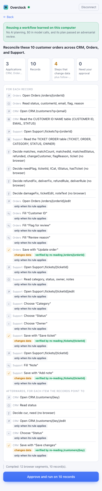
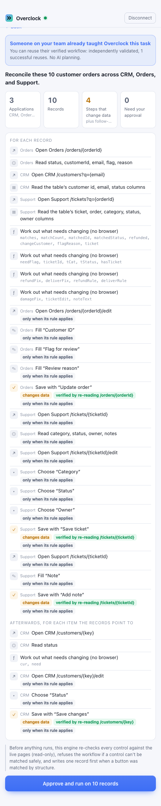

# Overclock for Chrome

**Describe it. Approve it. Overclock runs it.** The Chrome extension is Overclock's customer
interface: open the side panel, pick a workflow Overclock has learned (or describe a new task),
add records from a CSV, review exactly what will change, approve, and watch the run finish with
every change verified. Reruns of the same task reuse the learned workflow: no AI planning and no
model cost.



## What runs where

The extension is a control surface. It doesn't touch your tabs or read web pages.

```
Chrome side panel (apps/extension)
   │  pairing code → session token, kept in memory only
   ▼
Engine gateway  /api/x/*  on 127.0.0.1 (services/engine/src/extension.ts)
   │  workflow library, previews, runs, live events, receipts
   ▼
Overclock engine: compiler, scheduler, executor, verification, Overclock Network client
   │
   ▼
Overclock's own Chromium browsers (Playwright), on the same computer
```

- **Tasks run in Overclock's own browser**, which the engine starts and signs in to with its own
  configured accounts. They don't run in your Chrome tabs or your logged-in session. The side
  panel says so on every screen, and shows thumbnails of Overclock's pages while a run is in
  progress. Start the engine with `OVERCLOCK_HEADLESS=0` to see its browser windows too.
- **The demonstration environment is the Overclock arena**: mock CRM, Orders, and Support apps on
  `127.0.0.1:4101–4103`. It is not a real SaaS integration, and the panel labels it
  "Demonstration apps on this computer (Overclock arena)".
- **Extension-native tab execution and CDP attach** to your own Chrome are possible future
  adapters. They aren't built: they'd need their own allowlist, write-verification, and consent
  model, and the current runtime is untouched.

## The customer flow

1. **Connect.** The engine prints `Chrome extension pairing code: XXXX-XXXX-XXXX` when it starts
   (also in `<dataDir>/extension-pairing-code`). Enter it once per browser session.
2. **Choose a workflow.** "Learned workflows" lists what this engine has learned, with its apps,
   how many steps change data, and where it came from: **Learned here** or **From your team**.
   Choosing one shows the exact instructions it was learned for.
3. **Add records.** Drop a CSV whose header is the workflow's record fields (for the demo:
   `orderId`). The panel checks columns, blanks, duplicates, and size before anything is sent;
   the engine checks again.
4. **Preview.** The engine lowers and compiles the stored plan against these records and returns
   every step: what it opens, reads, and decides, which steps change data, how each change is
   verified, and which need approval. The banner says whether the run reuses a workflow learned
   here (no AI planning), reuses a teammate's validated workflow from the Overclock Network, or
   is a new task that needs AI planning (with a cost note and an explicit consent checkbox).
5. **Approve and run.** The panel follows the engine's real event stream through the dashboard's
   shared reducer: records done, changes verified, browser actions, AI calls, failures, the write
   canary, and approvals for irreversible steps.
6. **Results.** Records changed and verified, records that needed no change, records that need
   attention, time, and model cost, with per-record receipts (each verified field's value after
   the fresh read). Download the report as JSON or CSV, or run the workflow again on new records.


## Reuse, cold, and the team network

| Banner | When | What happens |
| --- | --- | --- |
| **Reusing a workflow learned on this computer** | This engine learned exactly this task before, and its plan passed an adversarial review | The cached plan runs (`knowledge: local-only`, warm cache): no model calls |
| **Someone on your team already taught Overclock this task** | Another authorized runtime published a validated capability for exactly this task | The engine imports it (`network-read`), re-checks every control against the live pages, writes one record first when a button changed, and verifies every write |
| **New task: Overclock will plan it with AI** | Nothing matches exactly | Discovery and planning with Claude (about $0.40–0.50 for a three-app task), then the same review and verification. Needs the consent checkbox and a configured model key |

Reuse always needs the **exact same operation**: the instructions' text, the record fields, and
the application origins. Nothing is matched by similarity. Instructions that state a batch size
("these 10 customer orders") can only run on that many records; the panel and the engine both
refuse a different count. The extension never publishes to the network.



## Security model

- **Pairing:** a 12-character code (about 60 bits), single use, valid 30 minutes, replaced after
  5 wrong guesses. It's exchanged for a 256-bit session token that expires after 12 hours.
- **The token lives in `chrome.storage.session`**, which Chrome keeps in memory and clears when
  it closes. The extension stores no API keys, no Overclock Network credentials, and no site
  passwords: the engine holds those.
- **Web pages can't use the gateway:** a request with an Origin header must come from a
  `chrome-extension://` origin (pin one id with `OVERCLOCK_EXTENSION_ID`), CORS is granted only
  to that origin, and the Host header must be `127.0.0.1` or `localhost`, which defeats DNS
  rebinding. The dashboard's localhost API is unchanged.
- **The engine re-derives every run** from the library and the approved preview. The extension
  can't send a run configuration, applications, or a knowledge policy. An approval is bound to
  the previewed records (a different batch is refused), and the extension can only see runs it
  started.
- **Permissions:** `sidePanel`, `storage`, and host access to `http://127.0.0.1` and
  `http://localhost` only. The extension pages' CSP limits `connect-src` to those hosts.
- **Every existing guarantee applies unchanged:** origin allowlists, compare-and-swap guards,
  write canaries, fresh read-back verification, no blind retries of uncertain writes, approval
  for irreversible steps, and the publication gate for skipped writes.

## Install and run

```bash
pnpm install
pnpm extension:build
```

In Chrome: open `chrome://extensions`, turn on **Developer mode**, choose **Load unpacked**, and
select `apps/extension/dist`. Pin **Overclock** and click it to open the side panel.

Startup sequence for the demo (no model calls):

```bash
pnpm arena
OVERCLOCK_HEADLESS=0 pnpm engine
pnpm extension:demo --seed 2222
```

`pnpm extension:demo` loads a fresh batch into the arena, writes it to
`.data/extension-demo/records-seed2222.csv`, and makes sure the engine's library holds the
workflow it learned in an earlier run for exactly this task (it adds the instructions to a
cached entry only after their identity matches the entry's key). Then, in the side panel:
connect to `http://127.0.0.1:4000` with the engine's pairing code, choose the workflow, drop the
CSV, preview, and approve. Check the result independently with the arena's grader:

```bash
pnpm cli check
```

For new records, run `pnpm extension:demo --seed 3333` and drop the new CSV.

Team network (optional): with SpacetimeDB up (`pnpm network:dev`), run
`pnpm network:demo --records 10 --seed 1111 --variation rename-save --no-cold-arm --a-warm-cache .data/scratch/a-cache --keep`.
It leaves runtime A (which published) and runtime B (which imported) running. Load new records
without touching B's library (`pnpm extension:demo --seed 5151 --no-library`), rename the save
buttons (`pnpm cli surprise rename-save`), and connect the extension to `http://127.0.0.1:4020`
with the code in `.data/demo/runtime-b/extension-pairing-code`.

## 90-second customer demo

**0–15 s.** Open the side panel. "Your ops team reconciles orders across a CRM, an order system,
and a support desk every day. Overclock learned that procedure once. Here it is in the library:
the exact instructions, the three apps, and the four steps that change data."

**15–35 s.** Drop today's CSV and press Preview. "Before anything runs, you see every step,
which ones change data, and how each change is checked. The banner says it's reusing a workflow
learned on this computer: no AI planning, no model cost."

**35–60 s.** Approve and run. Point at the counters and Overclock's browser windows. "Ten
records across three apps, each change read back from the page before it counts. A person does
this in about twenty minutes; this takes about a second of browser work."

**60–80 s.** The results. "Six records needed changes and all verified; four needed none.
Here's the receipt for one: the field and the value Overclock read back. Download it for the
audit trail." In a terminal, `pnpm cli check`: "And the environment's own grader, which
Overclock never sees: 10 of 10 correct, no duplicate or stray writes."

**80–90 s.** "Tomorrow, new records, same workflow, free. And if a teammate taught it, your
engine imports it from the Overclock Network and re-checks it against the live pages first."

## Tests

| Test | What it covers |
| --- | --- |
| `tests/unit/extension.test.ts` | SSE parsing, CSV parsing and validation, loopback-only engine addresses, event wording, progress from the shared reducer, record validation, stated batch sizes, pairing codes and tokens |
| `tests/integration/extension-gateway.test.ts` | The gateway over HTTP: pairing, tokens, refusal of web-page origins and rebinding hosts, CORS only for the extension, previews compiled from the stored plan, record checks, approval bound to the records, runs re-derived by the engine, the event stream read with the extension's client, receipts, owned runs only, consent for planning, a teammate's workflow from the network |
| `tests/integration/extension-ui.test.ts` | The built extension loaded unpacked in Chromium: the side panel pairs, picks a workflow, loads a CSV, previews, approves, follows the run, shows outcomes, and refuses a CSV with the wrong columns |
| `pnpm extension:smoke` | Against a real engine and the arena: the extension runs the learned workflow and the arena's checker must find every record correct (run on seeds 2222 and 3333, and as a network import on 5151, all 10/10 with 0 duplicate and 0 collateral writes) |

## Status

| | |
| --- | --- |
| Working | Pairing, workflow library, CSV records, previews from the compiled plan, local reuse, network reuse with rebinding and canary, live progress and thumbnails, approvals, results, receipts, JSON and CSV export, reuse on new records |
| Built, not exercised live | Planning a new task from the extension (needs model calls, which weren't authorized for this build); approval prompts (the demo workflow has no irreversible step) |
| Not supported | Running in your own Chrome tabs or session, real SaaS sign-in, publishing to the network from the extension, cross-team sharing |
| Demonstration only | The arena apps, `pnpm extension:demo` (it uses the arena's admin API, which the extension never touches), and the grader (`pnpm cli check`) |
